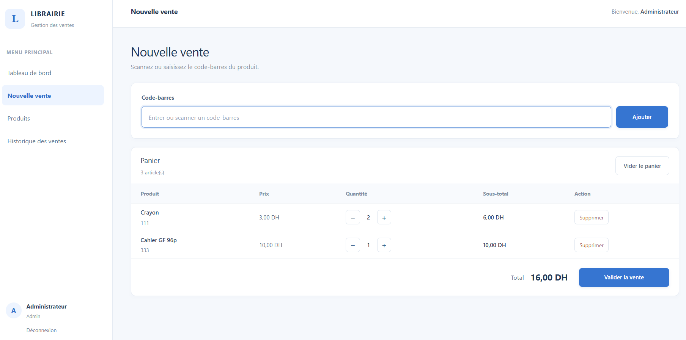
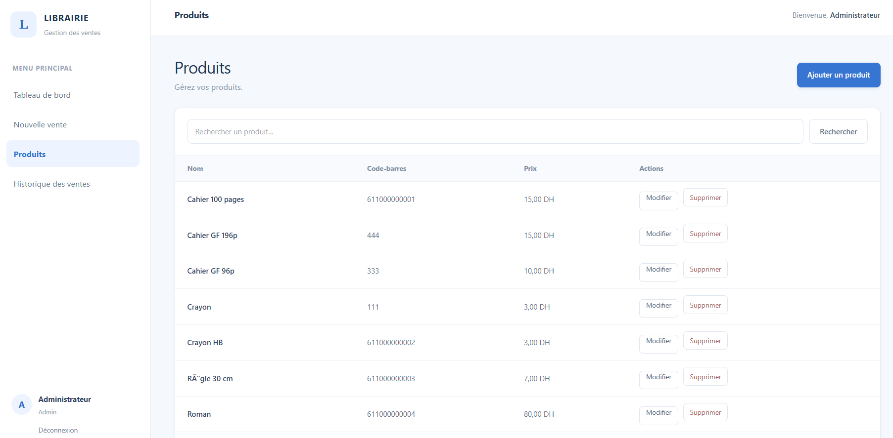
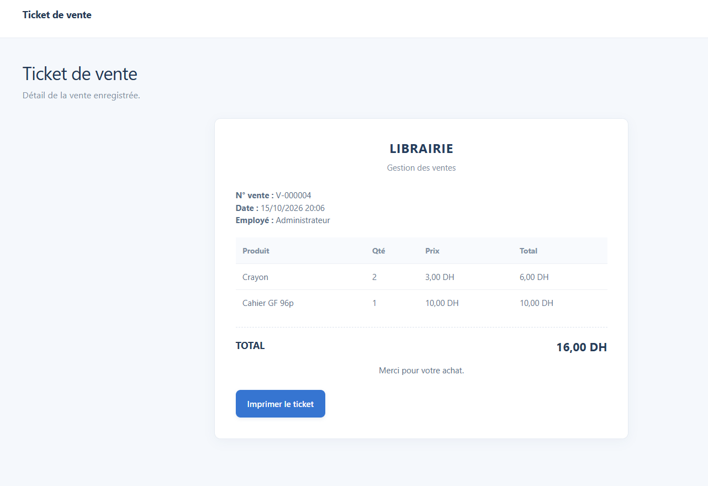
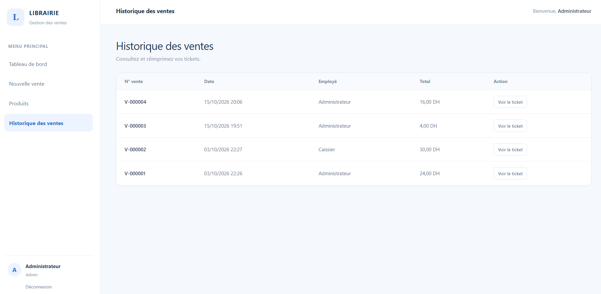
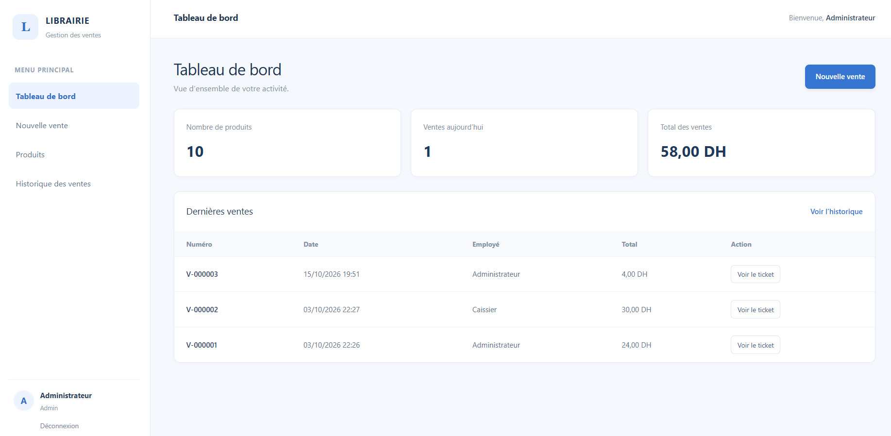

# Gestion des ventes — Librairie

Application web de gestion des ventes d'une librairie, développée avec Laravel et MySQL dans le cadre d'un projet personnel destiné à enrichir mon portfolio.

## Fonctionnalités

- Authentification des utilisateurs
- Gestion des produits (livres et fournitures scolaires)
- Recherche de produits
- Ajout et modification des quantités dans le panier
- Validation des ventes
- Génération et impression des tickets de vente
- Consultation de l'historique des ventes
- Gestion des rôles : administrateur et caissier

## Technologies utilisées

- PHP
- Laravel
- MySQL
- Blade
- HTML, CSS et JavaScript
- Vite et npm

## Auteur

Aya Karkoub

## Statut

Projet de démonstration réalisé pour mettre en pratique mes compétences en développement web.

## Captures d'écran

### Accueil

### Produits

### Ticket de vente

### Historiques des ventes

### Tableau de bord

